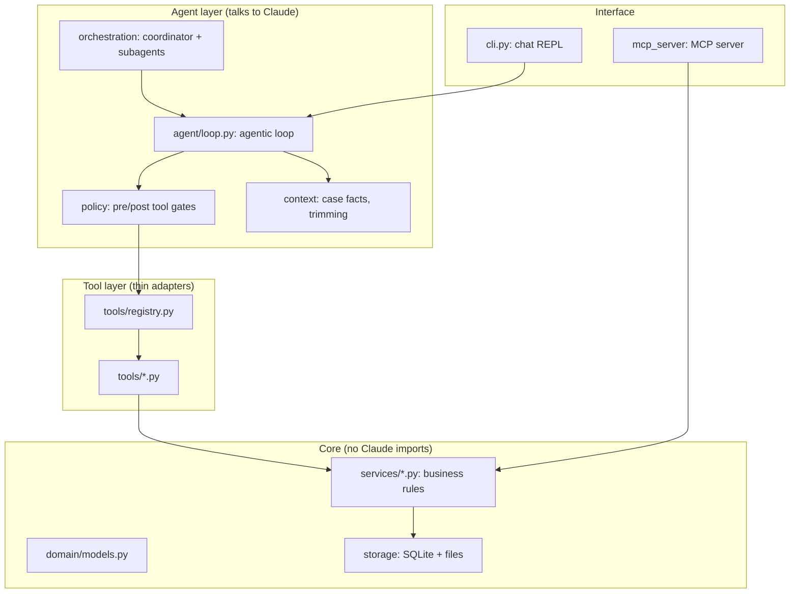

# Architecture

> Status: **target architecture**. Only the parts listed under "Implemented so far" exist in code.
> This file is updated whenever a lesson changes the structure.

## Implemented so far

- `src/workpilot/config.py`: typed settings (`Settings`, `get_settings()`), loaded from environment variables or the git-ignored dotenv file.
- `scripts/hello_claude.py`: a single Messages API call (smoke test, not part of the app).

## Layers



## The one rule that matters most

**`services/` never imports anything Claude-related.**

Business rules, such as "expenses over £500 need approval", live in plain Python functions.
Tools are thin adapters that translate between Claude's JSON and those functions.

Why:

- **Testable:** you can test the expense rule without calling an API.
- **Reusable:** the same service backs the local tool registry *and* the MCP server.
- **Replaceable:** swapping Claude surfaces (Messages API ↔ Agent SDK) does not touch business logic.

This is the same idea as keeping API calls out of React components and putting logic in hooks or services.

## Two ways we talk to Claude

| Surface | What it is | Where we use it |
|---|---|---|
| **Anthropic SDK** (`anthropic`) | Raw Messages API. We write the agentic loop ourselves | Chat loop, tools, extraction, batches, caching |
| **Claude Agent SDK** (`claude-agent-sdk`) | Claude Code as a library: built-in tools, subagents, hooks, sessions | Multi-agent research (lessons 1.2, 1.3, 1.5, 1.7) |

## Folder structure (target)

```text
src/workpilot/
├── config.py          # settings from environment variables
├── cli.py             # chat REPL entry point
├── llm/client.py      # Anthropic client wrapper
├── agent/loop.py      # the agentic loop
├── tools/             # registry + tool adapters + structured errors
├── services/          # business logic (no Claude imports)
├── storage/           # SQLite + file access
├── domain/models.py   # Pydantic models
├── prompts/           # system prompts, few-shot examples
├── extraction/        # structured extraction pipelines
├── context/           # context-window management
├── policy/            # deterministic gates (hooks)
├── orchestration/     # Agent SDK coordinator + subagents
├── mcp_server/        # MCP server exposing our tools
├── batch/             # Message Batches jobs
└── review/            # independent review passes
```

See [diagrams/system-architecture.md](diagrams/system-architecture.md) for the request flow.
