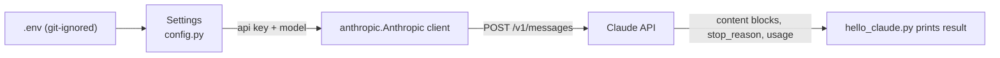

# Stage 0: Environment Setup

## 1. What are we learning?

How a modern Python project is laid out and run, and how to make a first call to Claude. We use **uv** to
manage Python, dependencies and the virtual environment, **pydantic-settings** for typed configuration,
and the **Anthropic Python SDK** for the API call.

## 2. Why do we need it?

Python installs packages globally by default, so two projects needing different versions of a library
clash. A **virtual environment** (`.venv/`) gives each project its own interpreter and packages. API keys
must never be committed, so configuration comes from a git-ignored `.env` file, validated at startup.

## 3. How does it work?

1. `uv init --package` creates `pyproject.toml` and the `src/workpilot/` package.
2. `uv python pin 3.13` writes `.python-version`. `uv sync` builds `.venv/` and installs the project into it.
3. `uv add` records dependencies in `pyproject.toml` and exact versions in `uv.lock`.
4. `Settings` (in `config.py`) reads `ANTHROPIC_API_KEY` and `WORKPILOT_MODEL` from the environment or `.env`
   and fails fast if the key is missing.
5. `scripts/hello_claude.py` builds an `anthropic.Anthropic` client from those settings and sends one message.

## 4. Simple flowchart



## 5. How does it connect to our project?

Every later lesson gets its configuration from `get_settings()` and its API access from the same SDK.
`hello_claude.py` is the seed of `llm/client.py` and the agentic loop in Lesson 1.1.

## 6. Implementation walkthrough

| File | Responsibility |
|---|---|
| `pyproject.toml` | Metadata, dependencies, `workpilot` CLI entry point, pytest and ruff config |
| `.python-version` | Pins Python 3.13 |
| `uv.lock` | Exact dependency versions (committed) |
| `.gitignore` | Keeps `.venv/`, `.env`, `data/` and caches out of git |
| `.env.example` | Variable names only; copied to `.env` by each developer |
| `src/workpilot/config.py` | `Settings` class + cached `get_settings()` |
| `tests/unit/test_config.py` | Config loading, default model, missing key, secret hiding |
| `scripts/hello_claude.py` | One Messages API call |

Key decisions:

- **`SecretStr`** for the API key, so it prints as `**********` in logs and tracebacks.
- **The key is passed explicitly** to `anthropic.Anthropic(api_key=...)`. pydantic-settings reads `.env` into
  `Settings` but does not export values to `os.environ`, where the SDK would otherwise look.
- **Iterate over `response.content`** and pick the `text` block. On current models (Opus 5.5, Sonnet 5.5)
  thinking is on by default, so the first block can be `thinking`.
- **Default model is `claude-sonnet-5-5`** ($2/$10 per million tokens, half of Opus 5.5) and can be changed
  with `WORKPILOT_MODEL`. The sample output below was recorded on Opus 5.5.

## 7. Important Python concepts

| Python | TypeScript equivalent |
|---|---|
| `class Settings(BaseSettings):` | `class Settings extends BaseSettings` |
| `workpilot_model: str = "claude-sonnet-5-5"` (class annotation) | a Zod field with `.default(...)` |
| `def main() -> None:` | `function main(): void` |
| `f"tokens: {n}"` | `` `tokens: ${n}` `` |
| `from workpilot.config import get_settings` | `import { getSettings } from "workpilot/config"` |
| `@lru_cache` on a no-arg function | a memoised lazy singleton |
| `if __name__ == "__main__":` | "only run when executed directly, not when imported" |
| pytest fixture `monkeypatch` (injected by parameter name) | `vi.stubEnv` |
| `.venv/` | `node_modules/` that also pins the runtime |

## 8. Execution walkthrough

```text
$ uv run python scripts/hello_claude.py
An agentic loop is a cycle where an AI model repeatedly decides on an action ...

---
model:         claude-opus-5-5
stop_reason:   end_turn
input tokens:  23
output tokens: 134
block types:   ['thinking', 'text']
```

`stop_reason: end_turn` means Claude finished naturally. Output tokens include hidden thinking.

## 9. How to test it

```bash
uv run pytest                                # 4 config tests pass, no API calls
uv run ruff check . && uv run ruff format --check .
uv run python scripts/hello_claude.py        # live call (needs ANTHROPIC_API_KEY in .env)
```

## 10. What should I remember?

- uv = Python version + venv + dependencies + lockfile in one tool. Commit `uv.lock`, never `.venv/`.
- Config is validated once at startup; secrets live only in the git-ignored `.env`.
- The Messages API is **stateless**: every request carries the full conversation.
- A response is a **list of content blocks**. Check `block.type`; never assume `content[0]` is text.
- `stop_reason` says *why* Claude stopped. The agentic loop in Lesson 1.1 is built on it.
